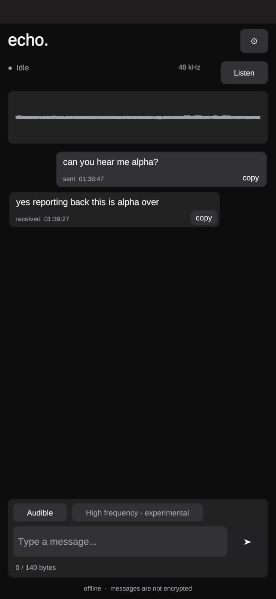
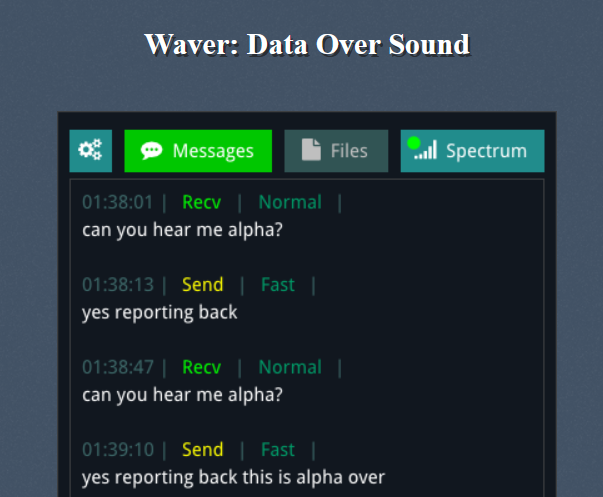

# ECHO — Offline Acoustic Communication

A fun project to message without internet and voice using [ggwave](https://github.com/ggerganov/ggwave).

## Demo screenshots

| ECHO on Android | Waver in a browser |
| --- | --- |
|  |  |
